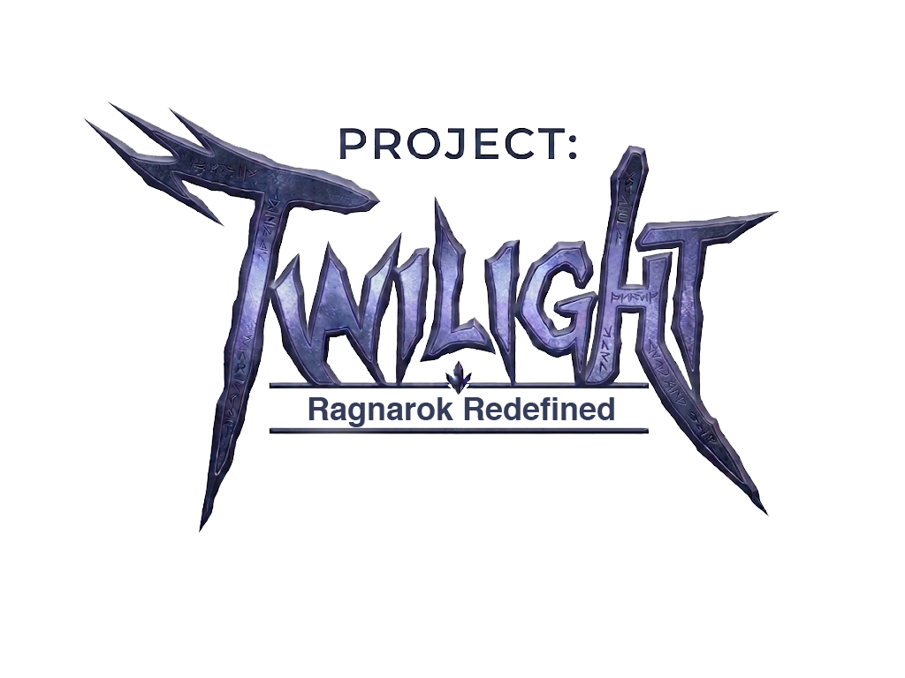

<p align="center">
  
</p>

<p align="center">
  <b>Classic Ragnarok's soul, modern presentation, native PC.</b><br>
  A standalone reimplementation of Pre-Renewal Ragnarok Online, built in Godot 4.8.
</p>

---

## What is Project Twilight?

Project Twilight is a native Windows reimplementation of **classic Pre-Renewal Ragnarok Online**. It is not a launcher, a wrapper around the original executable or another emulator. It is a new game client and simulation, written from scratch, that recreates the classic experience and adds modern rendering and usability.

It is planned to support three ways to play, all sharing one gameplay core:

| Mode | Description |
|---|---|
| **Offline single-player** | The full game locally, with no account, server or internet connection |
| **Private co-op** | Host a session and share an invitation code with friends over LAN, VPN or direct internet |
| **Persistent MMO** | Dedicated servers with persistent worlds, with configurable eAthena/Hercules integration as a goal |

### Bring your own data

Project Twilight **contains no Gravity game data**. On first launch you point it at your own Ragnarok Online data: a full client folder, or simply a folder containing `data.grf` and any patch archives. Sprites, maps and sounds are decoded directly from those archives, which are opened read-only and never modified or copied.

**No client executable is used.** Godot is the engine: the original launcher, patcher and `Ragexe` are not needed, only the data.

## Development status

> Early development. The resource pipeline is working; the playable game is not there yet.

| Area | Status |
|---|---|
| GRF archive reading (v0x200, v0x300) | ✅ Implemented and tested |
| Korean (CP949) resource paths | ✅ Implemented and tested |
| SPR sprites, palettes and ACT animations | ✅ Implemented and tested |
| Animated sprite rendering and Sprite Viewer tool | ✅ Implemented |
| Pre-Renewal stat formulas (core) | 🔧 In development |
| Co-op invitation codes | ✅ Implemented and tested · networking 📋 planned |
| Map decoding (GAT/GND/RSW) and ground rendering | ✅ Implemented and tested |
| Map models (RSM/RSM2: buildings, trees, props) | ✅ Implemented and tested (static) |
| Character sprites (body + head, hair dyes) and click-to-walk movement | ✅ Implemented and tested |
| Combat (Pre-Renewal hit/flee/crit/DEF/ASPD), monsters, EXP and levels | ✅ Implemented and tested (first monsters) |
| Twilight Glass HUD: status panel, target frame, HP bars, combat text | ✅ Implemented |
| Original class insignia for all 46 classes | ✅ Generated (polish ongoing) |
| Loot, inventory, item use, stat allocation | ✅ Implemented and tested |
| Local save/load (versioned, validated) | ✅ Implemented and tested |
| Equipment (weapon damage model, armor DEF, weapon sprites) | ✅ Implemented and tested |
| NPC merchant and shop (buy/sell, Zeny) | ✅ Implemented and tested |
| Character select and creation (classic stat hexagon, live preview) | ✅ Implemented and tested |
| Novice skills, skill window, F1–F9 hotkey bar, sitting and regen | ✅ Implemented and tested |
| Prontera ⇄ Prontera Field travel through warp portals | ✅ Implemented and tested |
| CPU adventurers (2–4 per map), name tags and minimap blips | ✅ Implemented and tested |
| Data-folder mount: GRF archives without a client executable | ✅ Implemented and tested |
| Server rates, autoloot and `@commands` | ✅ Implemented and tested |
| Kafra storage (300 slots, persisted with the character) | ✅ Implemented and tested |
| rAthena Kafra NPCs opening the storage window (`openstorage`) | ✅ Implemented and tested |
| Guild storage (shared 300-slot bag, `guildopenstorage`) | ✅ Implemented and tested |
| Job change to all six first jobs; Swordman skill tree | ✅ Implemented and tested |
| Other first-job skill trees, magic and elements, more maps and monsters | 📋 Next |
| First offline playable (character, map, monster, combat, save) | 📋 Planned |
| Private co-op sessions | 📋 Planned |
| eAthena / Hercules compatibility | 🔍 Under investigation, not claimed |
| Persistent MMO server | 📋 Planned |

The detailed plan is in [ROADMAP.md](ROADMAP.md).

## Classes

The Pre-Renewal target covers these classes:

| First job | Second jobs | Transcendent |
|---|---|---|
| Swordman | Knight / Crusader | Lord Knight / Paladin |
| Mage | Wizard / Sage | High Wizard / Professor |
| Archer | Hunter / Bard / Dancer | Sniper / Clown / Gypsy |
| Acolyte | Priest / Monk | High Priest / Champion |
| Merchant | Blacksmith / Alchemist | Whitesmith / Creator |
| Thief | Assassin / Rogue | Assassin Cross / Stalker |

Expanded classes (Super Novice, Taekwon, Star Gladiator, Soul Linker) are tracked separately. Renewal third jobs and Renewal mechanics are out of scope for the classic ruleset.

## Interface

Project Twilight's HUD uses its own **Twilight Glass** design language, a sleek anime-MMO "system window" style in the spirit of SAO and PSO2:
- frosted panels with chamfered corners and hairline borders
- slanted glowing resource bars
- condensed, letter-spaced typography

Classic information stays where veterans expect it: the status window is top-left. It fades when you aren't using it, wakes up when your HP or SP changes, and can be collapsed.

## Visual direction

The classic isometric camera, sprite characters and original map layouts stay. Lighting, effects, animation smoothness and UI are modernised on top of them, and each enhancement can be switched off independently of gameplay. Ragnarok M: Eternal Love is studied as a visual *reference* only. Its 3D Unity assets are not compatible with, or used in, this project.

## Getting started (development)

Requirements:
- Godot **4.8** (currently developed on 4.8-beta1)
- Your own Ragnarok Online data (a client folder, or a folder of `.grf` archives)
- Python 3 (only to regenerate the encoding table)

```bash
git clone https://github.com/XiONDiGiTaL/ProjectTwilight.git
```

1. Open `06_Godot_Project/project.godot` in Godot.
2. Run it, enter your data folder on the title screen and press **Mount**. Alternatively, set the `TWILIGHT_RO_CLIENT` environment variable, or create `06_Godot_Project/twilight.local.cfg` (git-ignored) containing:
   ```ini
   [resources]
   client_path="D:/Games/RagnarokOnline"
   ```
3. Choose **PLAY** and create a character. You start in the Novice Training Grounds, where the Training Guide offers the classic training or a skip straight to Prontera, the hub. On Windows you can also double-click `Play-ProjectTwilight.bat` (set the `GODOT` environment variable to your Godot executable if `godot` is not on your PATH).

**Controls**

| Key | Action |
|---|---|
| Left-click | Walk, attack, pick up loot or talk to NPCs |
| I | Inventory |
| S | Status |
| Q | Equipment |
| K | Skills |
| F1–F9 | Hotkeys |
| Insert | Sit |
| M | Minimap |
| Enter | Chat / `@commands` |
| U | Cycle aura |
| F12 | Save (progress also saves automatically) |

**Where to go**

- Portals connect every map (rAthena warp lists); Prontera's south gate leads to Prontera Field.
- **Job Guide / Job Master:** first and second jobs, including Dark Knight and Shaman.
- **Healer:** free full heal.
- **Kafra:** item storage in Prontera, west of the hub landing point. The official rAthena Kafra NPCs (save, storage, teleport, pushcart) also work and open the same window; their fee is the one written in `kafras.txt`. Twilight's own Kafra uses `kafra_fee` in `data/config.json` or `user://server.cfg` (0 = free).
- **Guild storage:** `@guild create <name>` founds or joins a guild, and a guild Kafra's guild-storage option opens one shared 300-slot bag for every member. Guilds and their storage live in `user://guilds.json`; character saves keep membership. Only one member can use the bag at a time. The Guild Keeper in Prontera, just east of the hub, opens it. Press `G` for the guild window: roster, invitations with accept/decline, invite and kick for the leader, and leave with automatic leadership succession.
- **Warper:** fast travel to any town, field or dungeon in your client.
- **Stylist:** hair style, hair colour and cloth dye.
- **Commands:** press **Enter** — `@go prontera`, `@heal`, `@rates`, `@mobinfo poring`, `@autoloot on`, `@save`, `@help`.
- Also: **Platinum Skills**, **Rental** and **Reset**.

The main menu also has a **Map Viewer** (fly around any classic map) and a **Sprite Viewer** (browse animated sprites from your client).

### Optional resource pack and rAthena NPCs

Put optional files in `Resources/` next to the Godot project. That folder is never committed:
- **Packs:** palette and sprite packs (`*.grf`, loose `sprite/` trees).
- **Font:** `GRADIUS.ttf` for battle text.
- **Shaman:** `Shaman.jpg` for the Shaman body.

The game also runs rAthena NPC scripts with its own interpreter (`scripts/npc/`). To use rAthena's healer, warper, job master, platinum skills, stylist, rental and reset NPCs, fetch just rAthena's `npc` folder into the pack:

```bash
git clone --depth 1 --filter=blob:none --sparse https://github.com/rathena/rathena.git Resources/rathena
git -C Resources/rathena sparse-checkout set npc
```

`06_Godot_Project/data/npc/scripts.txt` lists which scripts load. Without the rAthena folder, Project Twilight's own equivalents in `data/npc/twilight/` are used. See `docs/NPC_SCRIPTS.md`.

### Tests

```bash
godot --headless --path 06_Godot_Project -s res://tests/run_tests.gd
```

Unit tests use synthetic fixtures and need no game data. Client integration tests run automatically when a client folder is configured, and are skipped otherwise.

## Repository structure

```text
06_Godot_Project/    Godot project (scripts, scenes, tests)
tools/               Offline helper scripts
*.md                 Architecture, research and format documentation
```

The workspace also has local-only research folders (`01_Client_Original`, `09_Ragnarok_Eternal_Love`, …). These are excluded from the repository by an allow-list `.gitignore`.

## Documentation

[ARCHITECTURE](ARCHITECTURE.md) · [PROJECT_AUDIT](PROJECT_AUDIT.md) · [ASSET_FORMATS](ASSET_FORMATS.md) · [GAME_MECHANICS](GAME_MECHANICS.md) · [NETWORK_PROTOCOLS](NETWORK_PROTOCOLS.md) · [REVERSE_ENGINEERING_LOG](REVERSE_ENGINEERING_LOG.md) · [ASSET_PROVENANCE](ASSET_PROVENANCE.md) · [ROADMAP](ROADMAP.md) · [TODO](TODO.md) · [GUILD HANDOFF](docs/DIRECTIVE_GUILD_SOCIAL.md) · [CHANGELOG](CHANGELOG.md)

## License

Original Project Twilight code is licensed under the [Apache License 2.0](LICENSE). This license grants no rights to Gravity's intellectual property. Project Twilight is not affiliated with or endorsed by Gravity Co., Ltd. See [NOTICE](NOTICE) and [LICENSES.md](LICENSES.md).
