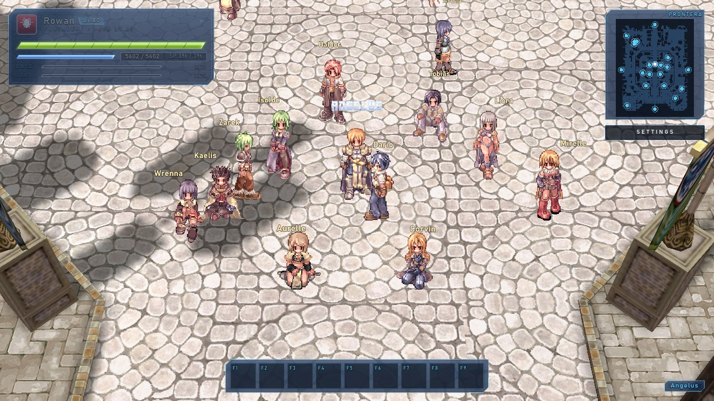
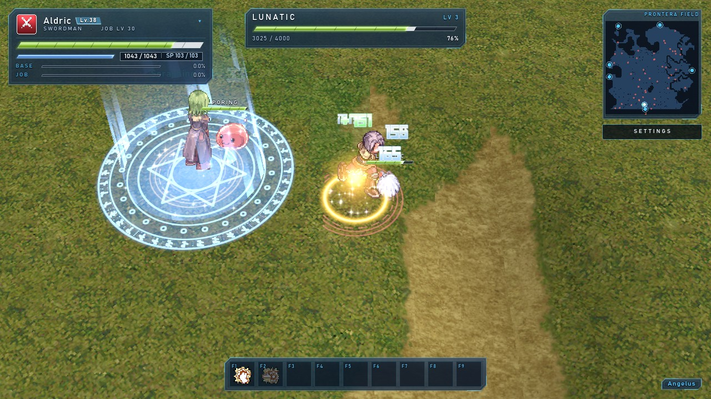
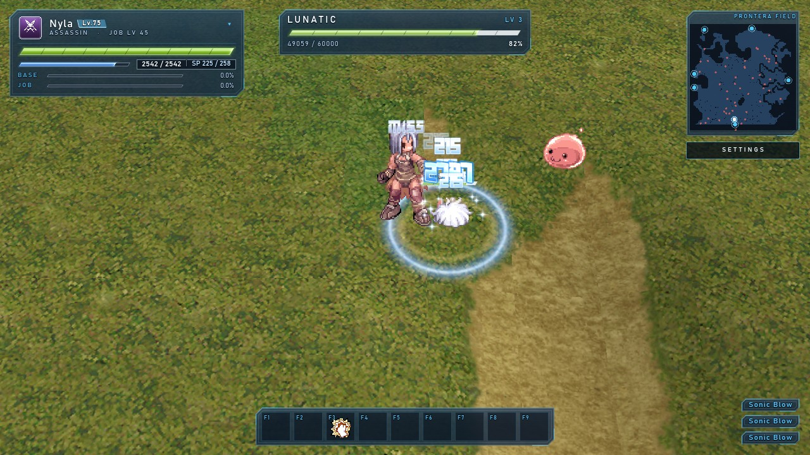
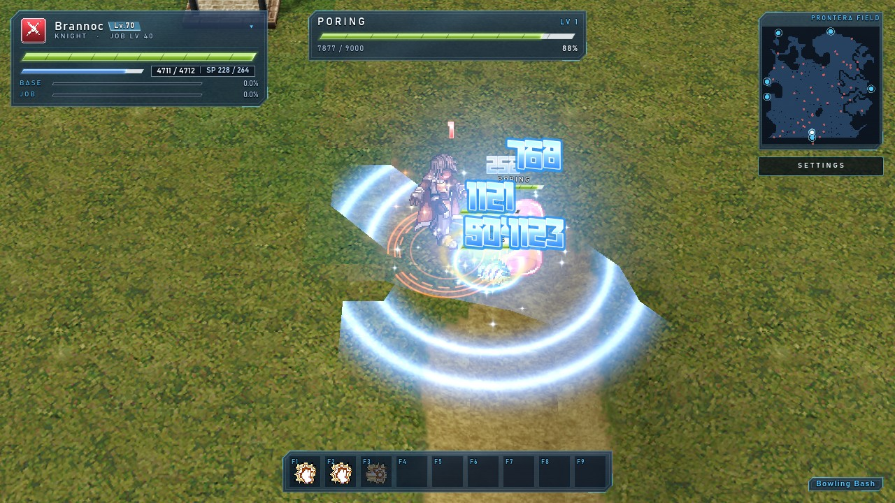
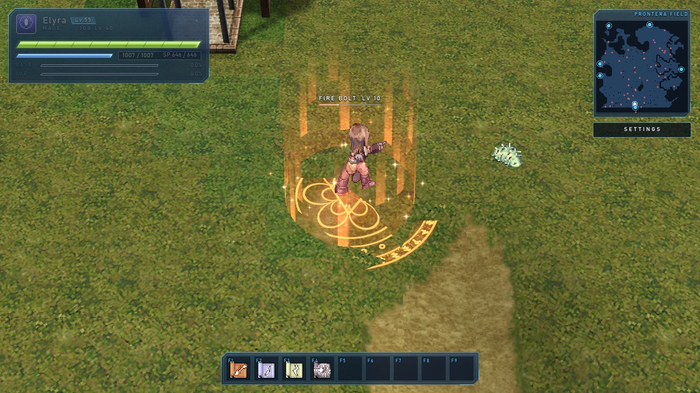
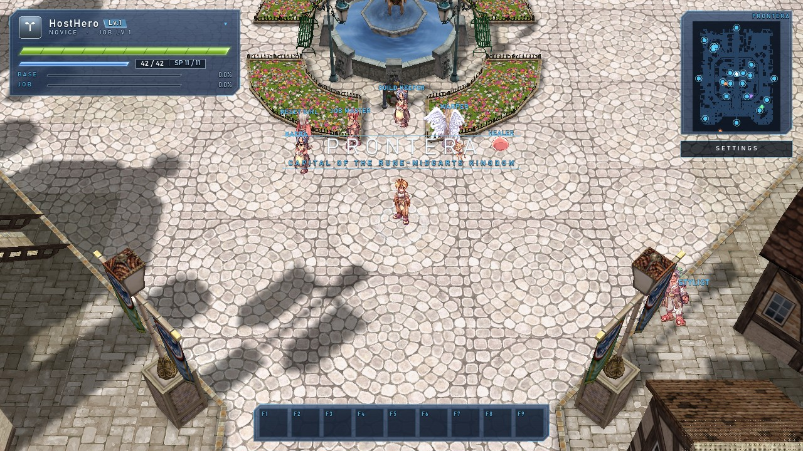
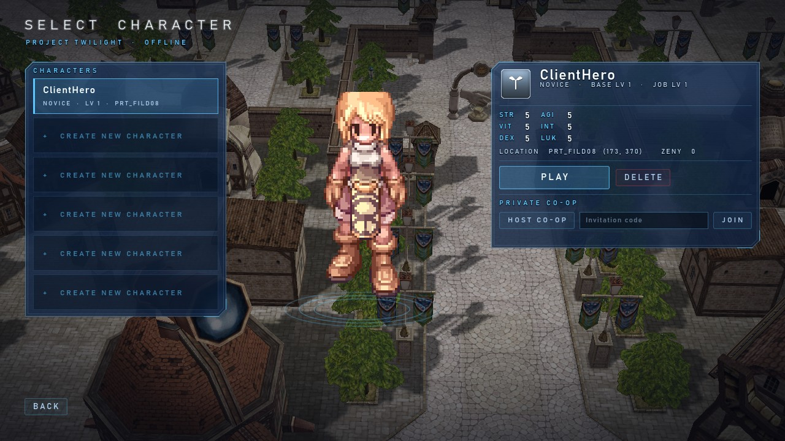

<p align="center">
  
</p>

<p align="center">
  <b>Classic Ragnarok's soul, modern presentation, native PC.</b><br>
  A standalone reimplementation of Pre-Renewal Ragnarok Online, built in Godot 4.8.
</p>

---

## What is Project Twilight?

Project Twilight is a native Windows reimplementation of **classic Pre-Renewal Ragnarok Online**. It is not a launcher, a wrapper around the original executable or another emulator. It is a new game client and simulation, written from scratch, that recreates the classic experience and adds modern rendering and usability.

It is planned to support three ways to play, all sharing one gameplay core:

| Mode | Description |
|---|---|
| **Offline single-player** | The full game locally, with no account, server or internet connection |
| **Private co-op** | Host a session and share an invitation code with friends over LAN, VPN or direct internet |
| **Persistent MMO** | Dedicated servers with persistent worlds, with configurable eAthena/Hercules integration as a goal |

### Bring your own data

Project Twilight **contains no Gravity game data**. On first launch you point it at your own Ragnarok Online data: a full client folder, or simply a folder containing `data.grf` and any patch archives. Sprites, maps and sounds are decoded directly from those archives, which are opened read-only and never modified or copied.

**No client executable is used.** Godot is the engine: the original launcher, patcher and `Ragexe` are not needed, only the data.

## Screenshots

Captured from the running game with `tests/capture_readme.gd`. The sprites, maps and effects icons come from the player's own Ragnarok Online data at run time; the interface, casting circles, damage text and lighting are Project Twilight's.

| | |
|---|---|
|  **Prontera, the hub.** Thirteen classes with their own body sprites, hair colours and cloth dyes: sitting, walking and blessing each other in the plaza. |  **CPU adventurers.** A Priest notices the player is hurt mid-fight, casts Heal (the green +751) and follows up with Angelus. |
|  **Sonic Blow.** An Assassin's multi-hit skill: the small numbers are the hits, the glowing blue number is the built-up total. |  **Area combat.** A Knight's Bowling Bash splashing a pack, with engaged HP bars and the target frame. |
|  **Magic.** Casting circles take the colour of the spell's element; the cast bar sits over the caster. |  **Private co-op.** The host's view of Prontera with a friend who joined by invitation code. |
|  **Character select.** PLAY offline, HOST CO-OP, or paste a code and JOIN. | |

## Development status

> Early development, but playable: create a character, train or skip to Prontera, fight, loot, change jobs, travel between maps, and host or join a private co-op session. Music and sound effects play from your own client. Monster variety is still very small (three species), and co-op has only been tested on one PC.

| Area | Status |
|---|---|
| GRF archive reading (v0x200, v0x300) | ✅ Implemented and tested |
| Korean (CP949) resource paths | ✅ Implemented and tested |
| SPR sprites, palettes and ACT animations | ✅ Implemented and tested |
| Animated sprite rendering and Sprite Viewer tool | ✅ Implemented |
| Pre-Renewal stat formulas (core) | 🔧 In development |
| Co-op invitation codes | ✅ Implemented and tested |
| Private co-op (host-authoritative ENet: HOST / JOIN from character select, shared maps, chat, remote NPC dialogs) | ✅ Implemented · tested between two game windows on one PC · LAN/internet and 3+ players not yet verified |
| Music (client `BGM` folder, per-map table) and sound effects (`data/wav`: weapons, skills, monsters, statuses, UI) | ✅ Implemented and tested |
| Own body sprites for all 39 second, transcendent and third jobs | ✅ Implemented (checked against the client) |
| Map decoding (GAT/GND/RSW) and ground rendering | ✅ Implemented and tested |
| Map models (RSM/RSM2: buildings, trees, props) | ✅ Implemented and tested (static) |
| Character sprites (body + head, hair dyes) and click-to-walk movement | ✅ Implemented and tested |
| Combat (Pre-Renewal hit/flee/crit/DEF/ASPD), monsters, EXP and levels | ✅ Implemented and tested (first monsters) |
| Twilight Glass HUD: status panel, target frame, HP bars, combat text | ✅ Implemented |
| Original class insignia for all 46 classes | ✅ Generated (polish ongoing) |
| Loot, inventory, item use, stat allocation | ✅ Implemented and tested |
| Local save/load (versioned, validated) | ✅ Implemented and tested |
| Equipment (weapon damage model, armor DEF, weapon sprites, bow/instrument/whip weapons, arrows and quivers) | ✅ Implemented and tested |
| NPC merchant and shop (buy/sell, Zeny) | ✅ Implemented and tested |
| Character select and creation (classic stat hexagon, live preview) | ✅ Implemented and tested |
| Novice skills, skill window, F1–F9 hotkey bar, sitting and regen | ✅ Implemented and tested |
| Prontera ⇄ Prontera Field travel through warp portals | ✅ Implemented and tested |
| CPU adventurers (2–4 per map), name tags and minimap blips | ✅ Implemented and tested |
| Data-folder mount: GRF archives without a client executable | ✅ Implemented and tested |
| Server rates (50× default, 1×/25×/50×/DEFAULT Settings presets), autoloot and `@commands` | ✅ Implemented and tested |
| Kafra storage (300 slots, persisted with the character) | ✅ Implemented and tested |
| rAthena Kafra NPCs opening the storage window (`openstorage`) | ✅ Implemented and tested |
| Guild storage (shared 300-slot bag, `guildopenstorage`) | ✅ Implemented and tested |
| Guild ranks (leader / officer / member) and permissions | ✅ Implemented and tested (local only, not networked) |
| Guild message of the day and guild chat (`/g`) | ✅ Implemented and tested (local only, not networked) |
| Job change to all six first jobs; all six first-job skill trees | ✅ Implemented and tested |
| More skill depth, magic and elements, more maps and monsters | 📋 Next |
| First offline playable (character, map, monster, combat, save) | ✅ Playable (`Play-ProjectTwilight.bat`) |
| eAthena / Hercules compatibility | 🔍 Under investigation, not claimed |
| Persistent MMO server | 📋 Planned |

The detailed plan is in [ROADMAP.md](ROADMAP.md).

## Classes

The Pre-Renewal target covers these classes:

| First job | Second jobs | Transcendent | Third job |
|---|---|---|---|
| Swordman | Knight / Crusader | Lord Knight / Paladin | Rune Knight / Royal Guard |
| Mage | Wizard / Sage | High Wizard / Professor | Warlock / Sorcerer |
| Archer | Hunter / Bard / Dancer | Sniper / Clown / Gypsy | Ranger / Minstrel / Wanderer |
| Acolyte | Priest / Monk | High Priest / Champion | Arch Bishop / Sura |
| Merchant | Blacksmith / Alchemist | Whitesmith / Creator | Mechanic / Genetic |
| Thief | Assassin / Rogue | Assassin Cross / Stalker | Guillotine Cross / Shadow Chaser |
| Swordman (custom) | Dark Knight | Dread Knight | Abyss Knight |
| Acolyte (custom) | Shaman | Oracle | Spirit Sage |

Every first job can now advance through its canonical second job, transcendent class and third job. The Dark Knight and Shaman lines keep separate custom continuations so their ids do not collide with canonical Lord Knight / High Priest. A third job needs a transcendent character at Base Level 99 / Job Level 70, raises the Base Level cap to 150 and keeps the Job Level cap at 70; every earlier class stays capped at Base Level 99. Every first job now has its own skill tree, every canonical second job and transcendent class has two dedicated skills, and Dread Knight and Oracle have their own continuations; third jobs keep their signature trees. Expanded classes (Super Novice, Taekwon, Star Gladiator, Soul Linker) are tracked separately, and Renewal mechanics beyond the third-job caps remain out of scope.

## Interface

Project Twilight's HUD uses its own **Twilight Glass** UI design as the traditional RO style is quite dated. Features include:
- frosted panels with chamfered corners and hairline borders
- slanted glowing resource bars
- condensed, letter-spaced typography
- every gameplay window drags from its title-bar grip, snaps to screen edges and neighbouring windows, and remembers its position; a subtle edge highlight confirms a viewport-border snap, and double-clicking the title bar resets it
- overhead name tags use a restrained 70% default scale, adjustable from 50–125% in **SETTINGS** (title screen, **Esc**, or the HUD button) with a **RESET** action back to 70%; the same scale covers NPCs, CPU players, warp labels and monster hover names, and the title-screen and in-game Settings windows each remember their own dragged position
- **SERVER RATES** in Settings switches Base EXP, Job EXP and drops between **1×, 25× and 50×**, with **DEFAULT** returning to the loaded server-config rates; the active choice is highlighted, saved with the player's settings, applies to the running field immediately with a system-feed confirmation, and a preset takes priority over server config defaults. The same choice is available from chat with `@rates 1|25|50|default`
- **RESET UI LAYOUT** in Settings returns every glass window—inventory, status, equipment, skills, shop, storage, guild and Settings itself—to its default position; Settings re-centers, a brief feed message confirms it, and every reset is remembered

Classic information stays where veterans expect it: the status window is top-left. It fades when you aren't using it, wakes up when your HP or SP changes, and can be collapsed.

## Visual direction

The classic isometric camera, sprite characters and original map layouts stay. Sprite bottoms are anchored to the ground plane so shoe and feet pixels are not cut off by the terrain. Lighting, effects, animation smoothness and UI are modernised on top of them, and each enhancement can be switched off independently of gameplay. Ragnarok M: Eternal Love is studied as a visual *reference* only. Its 3D Unity assets are not compatible with, or used in, this project.

## Getting started (development)

Requirements:
- Godot **4.8** (currently developed on 4.8-beta1)
- Your own Ragnarok Online data (a client folder, or a folder of `.grf` archives)
- Python 3 (only to regenerate the encoding table)

```bash
git clone https://github.com/XiONDiGiTaL/ProjectTwilight.git
```

1. Open `06_Godot_Project/project.godot` in Godot.
2. Run it, enter your data folder on the title screen and press **Mount**. Alternatively, set the `TWILIGHT_RO_CLIENT` environment variable, or create `06_Godot_Project/twilight.local.cfg` (git-ignored) containing:
   ```ini
   [resources]
   client_path="D:/Games/RagnarokOnline"
   ```
3. Choose **PLAY** and create a character. You start in the Novice Training Grounds, where the Training Guide offers the classic training or a skip straight to Prontera, the hub. On Windows you can also double-click `Play-ProjectTwilight.bat`. It finds Godot 4 by itself in this folder, on your PATH, or in a `Godot` folder on any drive; otherwise set the `GODOT` environment variable, or put the full path to the Godot executable in a `godot_path.txt` file next to the launcher. If it cannot find Godot it says so and waits instead of closing.

**Controls**

| Key | Action |
|---|---|
| Left-click | Walk, attack, pick up loot or talk to NPCs |
| I | Inventory |
| S | Status |
| Q | Equipment |
| K | Skills |
| F1–F9 | Hotkeys |
| Insert | Sit |
| M | Minimap |
| Enter | Chat / `@commands` |
| Esc | Open / close Settings |
| U | Cycle aura |
| F12 | Save (progress also saves automatically) |

A **SETTINGS** button below the minimap opens the same overlay for mouse users.

The overlay's **RESET UI LAYOUT** action returns every glass window to its default position, re-centers Settings and confirms the reset in the system feed. On the title screen the same action fades **UI layout reset.** into the status line, holds it for 2.5 seconds, then fades back to the client status.

**Where to go**

- Portals connect every map (rAthena warp lists); Prontera's south gate leads to Prontera Field.
- **Job Guide / Job Master:** every first job, its canonical second job and transcendent class, then a third job. The custom Dark Knight and Shaman lines also continue through Dread Knight → Abyss Knight and Oracle → Spirit Sage.
- **Healer:** free full heal.
- **Kafra:** item storage in Prontera, west of the hub landing point. The official rAthena Kafra NPCs (save, storage, teleport, pushcart) also work and open the same window; their fee is the one written in `kafras.txt`. Twilight's own Kafra uses `kafra_fee` in `data/config.json` or `user://server.cfg` (0 = free).
- **Guild storage:** `@guild create <name>` founds or joins a guild, and a guild Kafra's guild-storage option opens one shared 300-slot bag for every member. Guilds and their storage live in `user://guilds.json`; character saves keep membership. Only one member can use the bag at a time. The Guild Keeper in Prontera, just east of the hub, opens it. Press `G` for the guild window: roster with rank chips, invitations with accept/decline, and leave with automatic succession (an officer first, then a member).
- **Guild ranks:** members are a leader, officers or members. Officers can invite and kick ordinary members; only the leader can promote, demote, kick officers, transfer leadership or disband (the last two ask for confirmation). The window only shows the controls your rank allows, and the simulation enforces the same rules.
- **Guild message and chat:** leaders and officers can set a 200-character message of the day from the guild window; every member sees it when joining. Type `/g <message>` (or `/guild <message>`) to talk to online guild members; messages appear in the normal feed and are not persisted. Guild chat is local until the co-op transport exists.
- **Warper:** fast travel to any town, field or dungeon in your client.
- **Stylist:** hair style, hair colour and cloth dye.
- **Commands:** press **Enter** — `/g <message>` for guild chat, `@go prontera`, `@heal`, `@rates` (effective multipliers such as `x50`; `@rates 1|25|50|default` sets the Settings preset), `@mobinfo poring`, `@autoloot on`, `@save`, `@help`.
- Also: **Platinum Skills**, **Rental** and **Reset**.

The main menu also has a **Map Viewer** (fly around any classic map) and a **Sprite Viewer** (browse animated sprites from your client).

### Private co-op

One player hosts, friends join with an invitation code. The host's game decides everything (movement, combat, drops, NPC scripts); a guest's game mirrors it.

1. **Host:** on the character select screen pick a character and press **HOST CO-OP**. The game starts normally and the invitation code is copied to your clipboard and shown in the feed. `@code` in chat shows and copies it again; `@who` lists who is in the session.
2. **Guest:** pick a character, paste the code into **Invitation code** and press **JOIN**. You appear on the host's map with your own character, inventory and skills.
3. **Leaving:** `@leave` returns to the title screen. If the host leaves, guests are returned to the title screen with a message. Guests keep saving their own character to their own slot.

Notes and limits:
- The code contains the host's address, port and a one-time secret. Share it only with people you want in your game.
- Default port **7350 (UDP)**. On a home LAN or a VPN (Hamachi, ZeroTier, Tailscale) it works as is. Over the internet the host must forward that port and put the public address in `user://settings.cfg`:
  ```ini
  [coop]
  port=7350
  advertised_ip="203.0.113.10"
  ```
- Both players need the same maps in their own client data. Up to 8 players.
- Verified so far: two game windows on one PC (join, combat, chat, map travel, NPC dialogs). Not yet verified: a real LAN or internet link, three or more players, reconnecting.
- Design, protocol and known limits: [docs/DIRECTIVE_COOP_NETWORKING.md](docs/DIRECTIVE_COOP_NETWORKING.md).

### Music and sound

Project Twilight ships no audio. Music is read from your client's `BGM` folder (the track for each map comes from the client's `data/mp3nametable.txt`) and effects from `data/wav` inside the GRFs: weapon swings and hits, skill and spell sounds, monster voices, status effects, level-ups and UI clicks. **SETTINGS → AUDIO** has separate MUSIC and SOUND volumes. If you mounted only GRF archives without a `BGM` folder, the game simply plays without music.

### Optional resource pack and rAthena NPCs

Put optional files in `Resources/` next to the Godot project. That folder is never committed:
- **Packs:** palette and sprite packs (`*.grf`, loose `sprite/` trees).
- **Font:** `GRADIUS.ttf` for battle text.
- **Shaman:** `Shaman.jpg` for the Shaman body.

The game also runs rAthena NPC scripts with its own interpreter (`scripts/npc/`). To use rAthena's healer, warper, job master, platinum skills, stylist, rental and reset NPCs, fetch just rAthena's `npc` folder into the pack:

```bash
git clone --depth 1 --filter=blob:none --sparse https://github.com/rathena/rathena.git Resources/rathena
git -C Resources/rathena sparse-checkout set npc
```

`06_Godot_Project/data/npc/scripts.txt` lists which scripts load. Without the rAthena folder, Project Twilight's own equivalents in `data/npc/twilight/` are used. See `docs/NPC_SCRIPTS.md`.

### Tests

```bash
godot --headless --path 06_Godot_Project -s res://tests/run_tests.gd
```

Unit tests use synthetic fixtures and need no game data. Client integration tests run automatically when a client folder is configured, and are skipped otherwise.

For a window-by-window visual pass at 1280×720 and 1920×1080 (requires client data):

```bash
godot --path 06_Godot_Project -s res://tests/capture_ui_windows.gd
```

Screenshots and the pass/fail report go to `user://captures/ui_verify`.

## Repository structure

```text
06_Godot_Project/    Godot project (scripts, scenes, tests)
tools/               Offline helper scripts
*.md                 Architecture, research and format documentation
```

The workspace also has local-only research folders (`01_Client_Original`, `09_Ragnarok_Eternal_Love`, …). These are excluded from the repository by an allow-list `.gitignore`.

## Documentation

[ARCHITECTURE](ARCHITECTURE.md) · [PROJECT_AUDIT](PROJECT_AUDIT.md) · [ASSET_FORMATS](ASSET_FORMATS.md) · [GAME_MECHANICS](GAME_MECHANICS.md) · [NETWORK_PROTOCOLS](NETWORK_PROTOCOLS.md) · [REVERSE_ENGINEERING_LOG](REVERSE_ENGINEERING_LOG.md) · [ASSET_PROVENANCE](ASSET_PROVENANCE.md) · [ROADMAP](ROADMAP.md) · [TODO](TODO.md) · [GUILD HANDOFF](docs/DIRECTIVE_GUILD_SOCIAL.md) · [CHANGELOG](CHANGELOG.md)

## License

Original Project Twilight code is licensed under the [Apache License 2.0](LICENSE). This license grants no rights to Gravity's intellectual property. Project Twilight is not affiliated with or endorsed by Gravity Co., Ltd. See [NOTICE](NOTICE) and [LICENSES.md](LICENSES.md).
